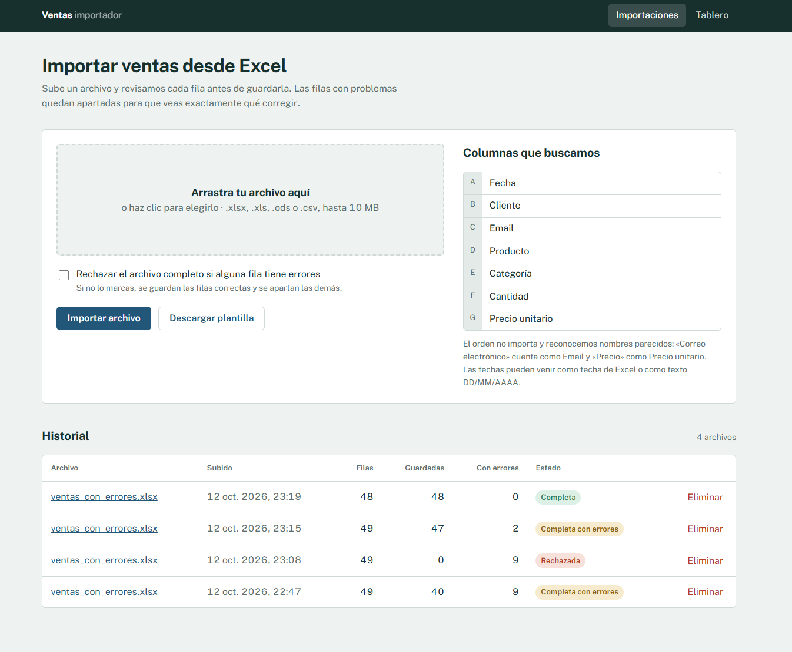

# 📊 Importador Inteligente de Ventas

Aplicación web hecha con **Laravel** para importar archivos de ventas en Excel. Reconoce los encabezados aunque vengan con otro nombre u orden, normaliza y valida cada fila, muestra los errores celda por celda y genera un tablero con las ventas válidas.

La lectura y generación de hojas de cálculo se hace con **PhpSpreadsheet**.



## ✨ Características

### Lectura flexible

- **Formatos soportados**: `.xlsx`, `.xls`, `.ods` y `.csv`, este último con detección automática de codificación (UTF-8, Windows-1252, etc.).
- **Encabezados flexibles**: se reconocen sin importar acentos, mayúsculas, espacios, orden o sinónimos. Por ejemplo, «Correo electrónico», «E-mail» y «EMAIL» se interpretan como *Email*, y «Precio» como *Precio unitario*.
- **Detección de la fila de encabezados**: se toma la primera fila con contenido, así que se toleran filas vacías arriba de la tabla.
- **Columnas desconocidas** que se ignoran y se reportan.

### Normalización antes de validar

- **Fechas** como fecha real de Excel o como texto en formatos `DD/MM/AAAA`, `DD-MM-AAAA`, `AAAA-MM-DD`, entre otros. Se rechazan fechas imposibles como `31/02/2026`.
- **Números** escritos como `1,250.50`, `1.250,50`, `12,5` o `$ 980`.
- **Categorías** con mayúsculas inconsistentes («ELECTRÓNICA», «electrónica») unificadas en un mismo formato.
- **Espacios sobrantes** eliminados y correos convertidos a minúsculas.

### Validación y resultados

- **Validación fila por fila** con el Validator de Laravel y mensajes en español.
- **Detección de filas duplicadas** dentro del mismo archivo.
- **Vista de errores** que replica la hoja: número de fila original, celda marcada y motivo, con filtro por columna y paginación.
- **Exportación de errores** a un Excel con las celdas en rojo y un comentario con el motivo, listo para corregir y volver a subir.
- **Plantilla descargable** con los encabezados correctos y validación de datos integrada.
- **Modo estricto** opcional: si hay un solo error, no se guarda ninguna venta.
- **Guardado seguro**: inserción por lotes de 500 filas dentro de una transacción, para que nunca quede una importación a medias.

### Tablero

- **Indicadores**: ingresos, número de ventas, ticket promedio, unidades vendidas y clientes únicos.
- **Gráficas** de ingresos por mes y por categoría, los 5 productos más vendidos y la calidad de las últimas importaciones (filas válidas contra filas con errores).
- **Filtro por importación** para ver los datos de un solo archivo.

## 📋 Columnas esperadas

| Columna             | Alias aceptados (ejemplos)                              | Validación                                   |
| ------------------- | ------------------------------------------------------- | -------------------------------------------- |
| **Fecha**           | Fecha de venta, Date, Día                               | Obligatoria, fecha válida y no futura        |
| **Cliente**         | Nombre, Nombre del cliente, Customer, Razón social      | Obligatorio, máximo 120 caracteres           |
| **Email**           | Correo, Correo electrónico, E-mail, Mail                | Obligatorio y con formato de correo válido   |
| **Producto**        | Artículo, Product, Descripción                          | Obligatorio, máximo 120 caracteres           |
| **Categoría**       | Category, Línea, Familia                                | Obligatoria, máximo 60 caracteres            |
| **Cantidad**        | Cant, Qty, Unidades, Piezas                             | Obligatoria, número entero de 1 a 100,000    |
| **Precio unitario** | Precio, P. unitario, Unit price, Costo unitario         | Obligatorio, número mayor que 0              |

Si falta alguna de estas columnas, el archivo se rechaza indicando cuáles faltan.

## 🛠️ Tecnologías

- [Laravel 13](https://laravel.com/) con [PHP](https://www.php.net/) 8.3 o superior
- [PhpSpreadsheet](https://phpspreadsheet.readthedocs.io/) para leer y generar hojas de cálculo
- [SQLite](https://www.sqlite.org/) como base de datos por defecto (compatible con MySQL y PostgreSQL)
- [Blade](https://laravel.com/docs/blade) para las vistas
- [Chart.js](https://www.chartjs.org/) para las gráficas del tablero
- [PHPUnit](https://phpunit.de/) para las pruebas
- [Docker](https://www.docker.com/) para el despliegue

## 📋 Requisitos

- PHP 8.3 o superior con las extensiones `zip`, `gd`, `xml`, `mbstring`, `fileinfo` y `pdo_sqlite`
- [Composer](https://getcomposer.org/)

## 🚀 Instalación y uso

1. Clona el repositorio:

   ```bash
   git clone https://github.com/SuemyDzib/importador-ventas.git
   cd importador-ventas
   ```

2. Instala las dependencias:

   ```bash
   composer install
   ```

3. Crea el archivo de entorno y genera la clave de la aplicación:

   ```bash
   cp .env.example .env
   php artisan key:generate
   ```

4. Crea la base de datos SQLite y ejecuta las migraciones:

   ```bash
   touch database/database.sqlite
   php artisan migrate
   ```

   En Windows, si `touch` no está disponible, crea un archivo vacío llamado `database.sqlite` dentro de la carpeta `database`.

5. (Opcional) Carga el archivo de ejemplo para tener datos en el tablero:

   ```bash
   php artisan demo:cargar
   ```

6. Inicia el servidor:

   ```bash
   php artisan serve
   ```

7. Abre `http://localhost:8000` en tu navegador.

### Archivo de ejemplo

En `ejemplos/ventas_con_errores.xlsx` hay un archivo para probar el importador. Tiene 49 filas, 9 de ellas con errores intencionales: correo inválido, cliente vacío, cantidad negativa y decimal, fecha imposible, fecha futura, precio no numérico, una fila con dos errores y una fila duplicada. También incluye una columna extra que se ignora.

### Pruebas

```bash
php artisan test --filter=SalesImportTest
```

Las pruebas cubren el guardado de filas válidas y el registro de las inválidas, el modo estricto, el rechazo por columnas faltantes o formatos no soportados, y la carga de las páginas.

### Archivos grandes

La aplicación acepta archivos de hasta 10 MB. Si trabajas con archivos grandes en tu entorno local, revisa los valores de `upload_max_filesize` y `post_max_size` en tu `php.ini`.

## 🗺️ Rutas

| Método   | Ruta                          | Descripción                                    |
| -------- | ----------------------------- | ---------------------------------------------- |
| `GET`    | `/importaciones`              | Formulario de carga e historial de importaciones |
| `POST`   | `/importaciones`              | Sube y procesa un archivo                      |
| `GET`    | `/importaciones/plantilla`    | Descarga la plantilla de Excel                 |
| `GET`    | `/importaciones/{id}`         | Resultado y errores de una importación         |
| `GET`    | `/importaciones/{id}/errores` | Descarga el Excel con los errores marcados     |
| `DELETE` | `/importaciones/{id}`         | Elimina una importación y sus ventas           |
| `GET`    | `/tablero`                    | Tablero de ventas                              |

## 🗃️ Base de datos

| Tabla               | Descripción                                                                         |
| ------------------- | ----------------------------------------------------------------------------------- |
| `imports`           | Una por archivo subido: nombre, estado, modo estricto, conteo de filas y resumen    |
| `sales`             | Ventas válidas, con el total calculado (`cantidad × precio_unitario`)               |
| `import_row_errors` | Filas con errores: número de fila original, valores y mensajes por columna          |

Al eliminar una importación se eliminan en cascada sus ventas y sus errores. Una importación puede terminar como *completada*, *con errores*, *rechazada* (modo estricto) o *fallida* (archivo ilegible o sin las columnas obligatorias).

## 📁 Estructura del proyecto

```
importador-ventas/
├── app/
│   ├── Http/
│   │   ├── Controllers/
│   │   │   ├── ImportController.php      # Subir, ver detalle, plantilla, exportar errores y eliminar
│   │   │   └── DashboardController.php   # Indicadores y datos de las gráficas
│   │   └── Requests/
│   │       └── UploadSpreadsheetRequest.php
│   ├── Models/                           # Import, Sale, ImportRowError
│   └── Services/Import/
│       ├── HeaderMapper.php              # Columnas esperadas y sus alias
│       ├── SalesImporter.php             # Lectura, normalización, validación y guardado
│       ├── SpreadsheetExporter.php       # Plantilla y Excel de errores
│       └── InvalidSpreadsheetException.php
├── database/migrations/                  # Tablas de importaciones, ventas y errores
├── docker/                               # Configuración de PHP y script de arranque
├── ejemplos/
│   └── ventas_con_errores.xlsx
├── resources/views/                      # Layout, importaciones y tablero
├── routes/
│   ├── web.php
│   └── console.php                       # Comando demo:cargar
├── tests/Feature/SalesImportTest.php
└── Dockerfile
```

## 🔧 Cómo adaptarlo a otros datos

1. Define tus columnas y sus alias en `HeaderMapper::COLUMNS`. Los alias se escriben normalizados: en minúsculas, sin acentos y con `_` en lugar de espacios.
2. Ajusta los métodos `normalize()`, `rules()` y `messages()` en `SalesImporter`.
3. Modifica la migración de la tabla `sales` y el arreglo `$valid[]` que se inserta en `SalesImporter`.
4. Actualiza las consultas del `DashboardController`.

## ☁️ Despliegue con Docker

El proyecto incluye un `Dockerfile` listo para servicios como [Render](https://render.com/). La imagen usa PHP con Apache, instala las extensiones necesarias y, al arrancar, ejecuta las migraciones, carga el archivo de ejemplo y cachea la configuración.

Para desplegarlo en Render, crea un **Web Service**, elige **Docker** como lenguaje y agrega estas variables de entorno:

| Variable    | Valor                                                       |
| ----------- | ----------------------------------------------------------- |
| `APP_KEY`   | Una clave generada con `php artisan key:generate --show`    |
| `APP_ENV`   | `production`                                                |
| `APP_DEBUG` | `false`                                                     |
| `APP_URL`   | La URL que te asigne Render                                 |

> En el plan gratuito de Render el disco es temporal: cada vez que el servicio se reinicia, la base de datos vuelve a empezar desde cero con los datos de ejemplo. Para una demo esto es práctico; para conservar los datos, usa una base de datos externa como MySQL o PostgreSQL.

## 📝 Decisiones y límites

- **Fechas ambiguas**: `05/03/2026` se interpreta como 5 de marzo (día primero, como se usa en México). Si tus archivos usan el mes primero, cambia el orden en `SalesImporter::DATE_FORMATS`.
- **Límite de 20,000 filas por archivo**, procesadas en la misma petición. Para archivos más grandes convendría mover el procesamiento a un *Job* en cola y leer el archivo por bloques con un `IReadFilter` de PhpSpreadsheet, para no cargarlo entero en memoria.
- **Sin autenticación**: cualquier persona con acceso a la app puede subir y eliminar importaciones. Antes de usarlo con datos reales, conviene agregar inicio de sesión (por ejemplo, con Laravel Breeze) y proteger las rutas con el middleware `auth`.

## 👤 Autor

Desarrollado por **Suemy Dzib** – [@SuemyDzib](https://github.com/SuemyDzib)
